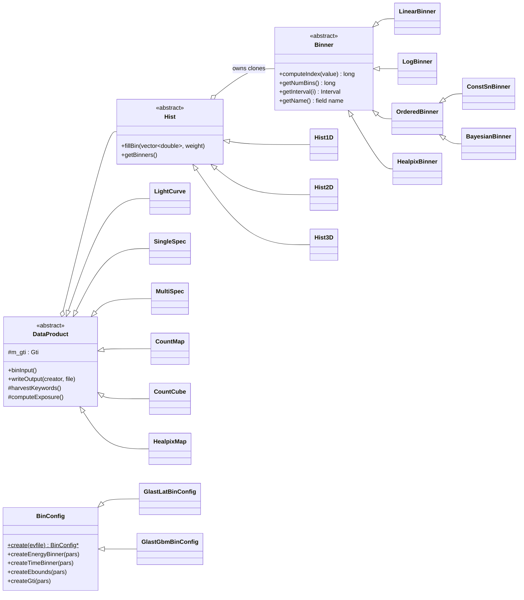

# evtbin Architecture

**evtbin** turns event lists (LAT FT1, or GBM TTE) into binned data
products. It is two things:

1. A **library** of binners, histograms, GTIs and "data products" that
   several other packages reuse.
2. The **`gtbin`** tool, which turns the library into the standard
   OGIP/FITS outputs (light curve, PHA1, PHA2, CMAP, CCUBE, HEALPix). There
   is also a small helper, **`gtbindef`**, that writes bin-definition files.

The original Doxygen mainpage (`src/mainpage.h`) was written in 2004. Its
parameter list, algorithm list and tool name ("evtbin") are out of date. Use
`pfiles/gtbin.par` and `src/gtbin/gtbin.cxx` as the source of truth.

## Purpose and scope

**Does:**
- Define 1-D binning strategies: linear, logarithmic, user-defined
  intervals, constant signal-to-noise, Bayesian Blocks, and HEALPix pixels.
- Fill 1-, 2- and 3-D histograms from `tip` tables.
- Represent and combine Good Time Intervals (`Gti`), and compute ONTIME.
- Compute EXPOSURE by prorating FT2 `LIVETIME` over the GTI. For GBM
  data, apply the deadtime correction instead.
- Write OGIP-style FITS products from templates. This includes copying
  known keywords, DSS (data subspace) keywords and HISTORY from the input,
  and writing EBOUNDS and GTI extensions.

**Does not:**
- Select events. `dataSubselector`/`gtselect` do that; evtbin bins
  whatever rows are in the input table.
- Compute instrument exposure maps. `Likelihood` (`gtexpcube2`) does that.
  "EXPOSURE" here means the livetime keyword or column.
- Generate responses (`rspgen`), or model or fit anything.

## Position in the system

| Direction | Package | Why |
|-----------|---------|-----|
| Depends on | `tip` | All FITS reading and writing. |
| Depends on | `astro` | `SkyDir`/`SkyProj` for map projections; `HealpixProj` for HEALPix keywords. |
| Depends on | `healpix` | `HealpixRegion` for partial-sky HEALPix maps. |
| Depends on | `st_app`, `hoops`, `st_stream` | Tool framework, parameter files, output. `BinConfig` takes `st_app::AppParGroup`, so the library itself depends on the parameter layer. |
| Depends on | `st_facilities`, `facilities` | `FileSys::expandFileList` (handles `@filelist` input), `commonUtilities::getDataPath` (finds templates). |
| Depends on | CLHEP | Linked `PRIVATE`. |
| Used by | `Likelihood` | `Binner`/`LinearBinner`/`LogBinner`/`OrderedBinner`, `HealpixBinner`/`HealpixMap`, `DataProduct`, `Gti`. These are used in counts maps, `HistND`, `gttscube`/`gthealcube` and `gtexpcube2`. |
| Used by | `dataSubselector` | `dataSubselector::Gti` **derives from `evtbin::Gti`**. Because of this, evtbin's GTI behaviour underlies `gtmktime` and every DSS GTI. |
| Used by | `rspgen` | `BinConfig`, binners, `Hist1D`/`Hist2D`, `Gti`. |
| Used by | `burstFit` | `BayesianBinner`, `Hist1D`. |
| Used by | `pyExposure` | `Gti` (SWIG-wrapped). |
| Linked by | `SolarSystemTools`, `sane` | CMake link only; no direct `#include`s. |

## Key abstractions

The library has four layers, from most generic to most specific:



| Layer | Types | Role |
|-------|-------|------|
| **Binner** | `Binner` and subclasses (`evtbin/*Binner.h`) | One binning dimension. A binner stores bin edges but no data. `getName()` is the **table column it reads** (e.g. `"TIME"`, `"ENERGY"`). `computeIndex` returns −1 for values out of range. Bins are half-open `[begin, end)`. |
| **Hist** | `Hist1D`, `Hist2D`, `Hist3D` | Dense count arrays. Each one owns *clones* of its binners (Strategy pattern). `Hist2D`/`Hist3D::getImage` flatten to FITS order (first axis fastest). |
| **Fill** | `RecordBinFiller` | Functor used with `std::for_each` over a `tip` table. For each binner, it reads `record[binner->getName()]` and calls `Hist::fillBin`. |
| **DataProduct** | `LightCurve`, `SingleSpec` (PHA1), `MultiSpec` (PHA2), `CountMap`, `CountCube`, `HealpixMap` | A histogram plus input-file bookkeeping (keywords, history, GTI, exposure) and an OGIP writer that works from a template in `data/`. |
| **Config** | `BinConfig`, `GlastLatBinConfig`, `GlastGbmBinConfig` (`src/`, private) | Prototype registry keyed by `TELESCOP::INSTRUME` (`GLAST`/`FERMI` × `LAT`/`GBM`). Turns `gtbin` parameters into binners and GTIs. The GBM version replaces energy binning with channel (`PHA`) binning taken from the input's `EBOUNDS`, and builds a GTI from the first and last event times. |
| **GTI** | `Gti` | `std::map<start, stop>` that stays merged. Supports `&` (intersection), `|` (union), `getFraction(tstart, tstop, hint)` and `computeOntime()`. |

### Data products and their files

| `algorithm` | Class | Histogram (binner order) | Template (`data/`) | Primary output | Extra HDUs |
|-------------|-------|--------------------------|--------------------|----------------|------------|
| `LC` | `LightCurve` | `Hist1D(time)` | `LatLightCurveTemplate` | `RATE` table: `TIME` (bin midpoint), `TIMEDEL`, `COUNTS`, `ERROR` | GTI (trimmed to the time-binner range) |
| `PHA1` | `SingleSpec` | `Hist1D(energy)` | `LatSingleBinnedTemplate` | `SPECTRUM`: `CHANNEL`, `COUNTS`, `STAT_ERR` | EBOUNDS, GTI |
| `PHA2` | `MultiSpec` | `Hist2D(time, energy)` | `LatBinnedTemplate` | `SPECTRUM`, one row per time bin: `TSTART`, `TELAPSE`, `SPEC_NUM`, vector `CHANNEL`/`COUNTS`/`STAT_ERR`, per-row `EXPOSURE` | EBOUNDS, GTI |
| `CMAP` | `CountMap` | `Hist2D(x, y)` in projected pixel space | `LatCountMapTemplate` | Primary image with WCS keywords | GTI |
| `CCUBE` | `CountCube` | `Hist3D(x, y, energy)` | `LatCountCubeTemplate` | Primary 3-D image | EBOUNDS, GTI |
| `HEALPIX` | `HealpixMap` | Own `[energy][pixel]` array plus `HealpixBinner` | `LatHealpixTemplate` | `SKYMAP` table: `CHANNEL1..N` columns, plus `PIX` for partial sky | EBOUNDS, GTI |

## Data flow and control flow

### `gtbin`

`src/gtbin/gtbin.cxx` contains every application class. `GtBinApp` is the
`st_app` entry point. It prompts only for `algorithm`, then creates the
matching `EvtBinAppBase` subclass (`LightCurveApp`, `SingleSpectrumApp`,
`MultiSpectraApp`, `CountMapApp`, `CountCubeApp`, `HealpixMapApp`), copies
the parameter group into it, and runs it.

```
GtBinApp::run
  BinConfig::load()                       // register LAT/GBM prototypes
  prompt "algorithm" → choose XxxApp
  XxxApp::run  (EvtBinAppBase::run)
    prompt evfile, evtable
    BinConfig::create(evfile)             // read TELESCOP/INSTRUME → clone LAT or GBM config
    parPrompt()                           // per-product: outfile, scfile, time/energy/spatial pars
    pars.Save()
    createDataProduct(pars)               // build binners via BinConfig, Gti(evfile[GTI]), then the product
      └─ DataProduct ctor: expand @filelist; harvest keywords/history from
         primary, GTI, [EBOUNDS], EVENTS; adjust TSTART/TSTOP; compute EXPOSURE, ONTIME
    product->binInput()                   // for each input file: for_each row → RecordBinFiller (or custom loop)
    product->writeOutput("gtbin <ver>", outfile)
      └─ createFile(template) → updateKeywords → write data HDU → EBOUNDS → GTI
```

### EXPOSURE

`DataProduct::computeExposure` handles LAT data:
- It opens every FT2 file (with `@list` expansion), sorts them by time,
  and warns about gaps between files.
- For each FT2 row it adds `fraction-of-[START,STOP)-inside-GTI × LIVETIME`.
- If `scfile` is `NONE`, EXPOSURE is set to ONTIME and a warning is
  printed. For PHA1 and PHA2 with LAT data, `gtbin` refuses to run without
  a spacecraft file.

`DataProduct::gbmExposure` handles GBM data. It runs only when the input has
an `EVT_DEAD` keyword, and uses
`ONTIME − counts·EVT_DEAD − overflow_counts·EVTDEDHI`.

### `gtbindef`

`gtbindef` reads an ASCII file of `start stop` pairs and writes an
`ENERGYBINS` table (converted to keV, from `LatEnergyBinDef.tpl`) or a
`TIMEBINS` table (from `LatTimeBinDef.tpl`). `gtbin` then reads these back
when `ebinalg=FILE` or `tbinalg=FILE`.

## Public interfaces

### Applications

| Tool | Par file | Notes |
|------|----------|-------|
| `gtbin` | `pfiles/gtbin.par` | `algorithm` ∈ {`CCUBE`, `CMAP`, `LC`, `PHA1`, `PHA2`, `HEALPIX`}. `ebinalg` ∈ {`FILE`, `LIN`, `LOG`}; `tbinalg` ∈ {`FILE`, `LIN`, `SNR`}. Hidden: `evtable=EVENTS`, `sctable=SC_DATA`, `efield=ENERGY`, `tfield=TIME`, `rafield`, `decfield`. |
| `gtbindef` | `pfiles/gtbindef.par` | `bintype` E or T; `energyunits` for E. |

User-facing help text lives in `fermitools-fhelp`, not here.

### C++ library

Headers are in `evtbin/`. The headers other packages actually use are
`Binner.h`, `LinearBinner.h`, `LogBinner.h`, `OrderedBinner.h`, `Gti.h`,
`Hist1D.h`, `Hist2D.h`, `Hist.h`, `HealpixBinner.h`, `HealpixMap.h`,
`DataProduct.h`, `BinConfig.h`, `BayesianBinner.h`. Changes to `Gti` or
`Binner` behaviour reach `dataSubselector`, `Likelihood` and `rspgen`.

Minimal library use:

```cpp
evtbin::LogBinner ebins(100., 1.e5, 20, "ENERGY");   // name = column to read
evtbin::Gti gti("ft1.fits");                          // reads [GTI]
evtbin::SingleSpec pha("ft1.fits", "EVENTS", "ft2.fits", "SC_DATA", ebins, ebins, gti);
pha.binInput();
pha.writeOutput("mytool 1.0", "out.pha");
```

### Python

None directly. `Gti` is exposed through `pyExposure`'s SWIG interface, and
`gtbin` is wrapped by `sane`'s `gt_apps`.

### File formats

- **Inputs:** FT1 or GBM TTE (`EVENTS` + `GTI`, and `EBOUNDS` for GBM), FT2
  (`SC_DATA`), bin-definition files (`ENERGYBINS`/`EBOUNDS` with
  `E_MIN`/`E_MAX` in keV; `TIMEBINS`/`GTI` with `START`/`STOP`). Any input
  file argument may be an `@filelist`.
- **Outputs:** the products in the table above. Energies are **MeV inside
  the library** and **keV in every EBOUNDS / ENERGYBINS HDU**.

## Build and test

- **CMake target:** `evtbin` is a **STATIC** library. CMake builds it with
  position-independent code (set globally in the top-level `CMakeLists.txt`),
  and it gets linked into each shared library that uses it. Executables:
  `gtbin`, `gtbindef`, `test_evtbin`.
- **Install:**
  - headers go to `include/evtbin`
  - `pfiles/` goes to `syspfiles`
  - `data/` (templates and test inputs) goes to
    `${FERMI_INSTALL_REFDATADIR}/evtbin`
  - `data/outref/` goes to `${FERMI_INSTALL_DATADIR}/evtbin/outref`
- **Runtime data lookup:** `gtbin` and `gtbindef` find their FITS templates
  through `facilities::commonUtilities::getDataPath("evtbin")`, which
  resolves to `$FERMI_INST_DIR/refdata/fermi/evtbin`. If `FERMI_INST_DIR`
  is unset (for example, outside an activated Fermitools environment),
  template creation fails.
- **`test_evtbin`:**
  - It is an `st_app` application (`pfiles/test_evtbin.par`), so `PFILES`
    must be set up. It is **not registered with CTest**.
  - It runs about 17 test groups covering every binner, `Hist1D`/`Hist2D`,
    every product, `BinConfig` (LAT and GBM), `Gti` and multi-file input. If
    any check fails, it throws `"Unit test failed"`.
  - Inputs are the small `ft1tiny*.fits`, `ft2tiny*.fits`, `ft1small.fits`
    and `gbmtiny.fits` files in `data/`.
  - It writes products (`LC1.lc`, `PHA1.pha`, `PHA2.pha`, `test.healmap`, …)
    to the **current directory**, so run it from a scratch directory.
  - `data/outref/` holds reference copies of those outputs, but nothing in
    this repo compares against them. The comparison happens outside the
    repo, if at all.
- **Test data provenance:** `data/README.txt` describes how the tiny FT1
  and FT2 files were cut from DC2 data around the Crab.
- **Legacy:** `SConscript` and `evtbinLib.py` belong to the old SCons build.

## Invariants and gotchas

**Units and conventions**
- Energies are MeV in parameters and inside binners. Every EBOUNDS and
  ENERGYBINS HDU is keV. `BinConfig` multiplies by 1e-3 when reading
  bin files, `writeEbounds` multiplies by 1000, and `gtbindef` converts the
  user's `energyunits` to keV.
- A binner's *name* is the input column it reads. Changing `efield` or
  `tfield` changes which column gets binned.
- Bins are `[begin, end)`, except in `ConstSnBinner`, which uses
  `(begin, end]`.
- `LightCurve` writes the bin **midpoint** to `TIME`.

**Parameters vs. behaviour**
- `tbinalg` has no `LOG` option in the par file, although the code
  supports it. `ntimebins` is referenced in `BinConfig` but is not in
  `gtbin.par`.
- With `tbinalg=SNR`, `gtbin` prompts for `lcemin`/`lcemax`, but
  `ConstSnBinner::computeIndex` **ignores them** (the energy test is
  commented out). The background coefficients are always empty, so the
  bins close when `counts ≥ snratio²`.
- If `tstart`/`tstop` cannot be read from the parameter (for example,
  INDEF), `BinConfig::timeParDefaults` falls back to the `TSTART`/`TSTOP`
  keywords of the `EVENTS` extension.
- `HEALPIX` maps always read the `RA`/`DEC` or `L`/`B` columns. They
  **ignore `rafield`/`decfield`**.
- `proj` must be at most 3 characters (`CountMap` checks this, because
  longer names crashed wcslib).

**Stateful binners**
- `ConstSnBinner` and `BayesianBinner` define their bins *while* the data
  is filled. `computeIndex` is `const` but changes `mutable` state, and
  `Hist1D::fillBin` grows its array to fit. A `ConstSnBinner` must see
  events **in time order and only once**, so reusing or cloning one after a
  fill carries its state along.

**Output keywords**
- Only the keywords in `DataProduct`'s known-keys list, plus DSS
  keywords, are carried from input to output, and only if the template
  already contains them. `DETNAM` and `TRIGTIME` are always written. The
  known-keys list misspells `EQUNINOX`, so `EQUINOX` is never harvested.
  This is harmless today because every template hard-codes
  `EQUINOX = 2000`.
- `TSTART`/`TSTOP` are narrowed to the time binner's range (`LC`, `PHA2`),
  but the **GTI HDU is trimmed only for `LC`**. `PHA2` writes the full
  input GTI.
- `DATE` uses `localtime`, not UTC.

**Exposure**
- When the FT2 data does not cover the GTI, the result is a *warning*
  (`"EXPOSURE keyword calculation may not be accurate"`), not an error.
- `PHA2` computes the `EXPOSURE` of each row by constructing a full
  `SingleSpec` for that time bin. That re-reads the input headers and
  rescans the **entire** FT2 file once per time bin, so the cost is
  roughly O(time bins × FT2 rows). Expect it to be slow for fine time
  binning over long FT2 files.
- In the GBM deadtime code, channels with index > 126 count as the
  overflow ("error") channel. This happens even for LAT data, but it has no
  effect there because `gbmExposure` returns early unless `EVT_DEAD` is
  present.
- **Possible bug (from reading the code):** `gbmExposure` and
  `MultiSpec::writeOutput` dereference the `EVTDEDHI` lookup without
  checking it. Input that has `EVT_DEAD` but no `EVTDEDHI` would be
  undefined behaviour.

**Count cubes**
- `CCUBE` writes a *linear* third WCS axis: `CRVAL3` is the first bin's
  lower edge and `CDELT3` is the first bin's width. With `ebinalg=LOG` (the
  default) that axis does not describe the real energies. Use the EBOUNDS
  HDU, as `Likelihood` does.

**HEALPix**
- `hpx_ebin=no` makes `gtbin` set `enumbins=1, emin=emax=0`. The single
  EBOUNDS row is then the observed min and max event energy.
- `HealpixMap::binInput` takes its starting minimum energy from the first
  row of each input file, which assumes the file is not empty. It also
  resets that minimum for every file when the input is an `@filelist`
  (from reading the code; not checked at runtime).
- `hpx_order` must be 0–12. Partial-sky maps (`hpx_region`) write
  `INDXSCHM=EXPLICIT` and a `PIX` column.

**GTI**
- `Gti::insertInterval(double, double)` re-merges the whole map on every
  call, which is O(n) per insert. Prefer building with the protected
  `insertInterval(Interval_t)` and calling `consolidate()` once, as the
  file constructor does.
- `Gti::setNumIntervals` does nothing.
- The second branch in `Gti::consolidate` can never run, because the map
  is sorted by start time.

**Static library in shared libraries**
- `evtbin` is static and is linked into several shared libraries
  (`dataSubselector`, `Likelihood`, `rspgen`, …), so each of those carries
  its own copy of evtbin's code and statics, including
  `BinConfig::s_config_cont`. Avoid adding new global state here
  (inferred; this has not caused a known problem).

## Extension points

- **New binning algorithm:** subclass `Binner` (or `OrderedBinner` if the
  bins are computed). Then wire it into `BinConfig::parPrompt` and
  `BinConfig::createBinner` under a new `ebinalg`/`tbinalg` keyword, and
  add that keyword to the allowed values in `pfiles/gtbin.par`.
- **New output product:**
  1. Subclass `DataProduct`. In the constructor, harvest keywords from the
     primary, GTI and events HDUs and call `adjustTimeKeywords`.
  2. Implement `writeOutput` with `createFile(template)`, then the data
     HDU, then `writeEbounds`/`writeGti`.
  3. Add a FITS template to `data/`.
  4. Add an `XxxApp : EvtBinAppBase` in `gtbin.cxx`, and add a new
     `algorithm` value to `GtBinApp::run` and the par file.
- **New mission or instrument:** subclass `BinConfig`, override what
  differs (see `GlastGbmBinConfig`), register it under
  `"TELESCOP::INSTRUME"` in a static `load()`, and call that from
  `BinConfig::load()`.
- **New carried-over keyword:** add it to `m_known_keys` in the
  `DataProduct` constructor *and* to the relevant templates. To force it
  into the output even when the template lacks it, also add it to
  `m_default_keys`.

Before merging changes to `Gti`, `Binner` or `DataProduct`, run
`test_evtbin` and also the `dataSubselector`, `rspgen` and `Likelihood`
tests.

## Further reading

- `src/mainpage.h`: the original design notes (2004), including the
  Binner/Hist/DataProduct rationale. The parameter details are stale.
- `data/README.txt`: provenance of the test data.
- `doc/release.notes`: history up to the move to git.
- Scargle et al., *Studies in Astronomical Time Series Analysis VI*
  (Bayesian Blocks), the basis of `BayesianBinner`.
- OGIP standards for light curves (OGIP/93-003), spectra (OGIP/92-007)
  and HEALPix FITS conventions.
